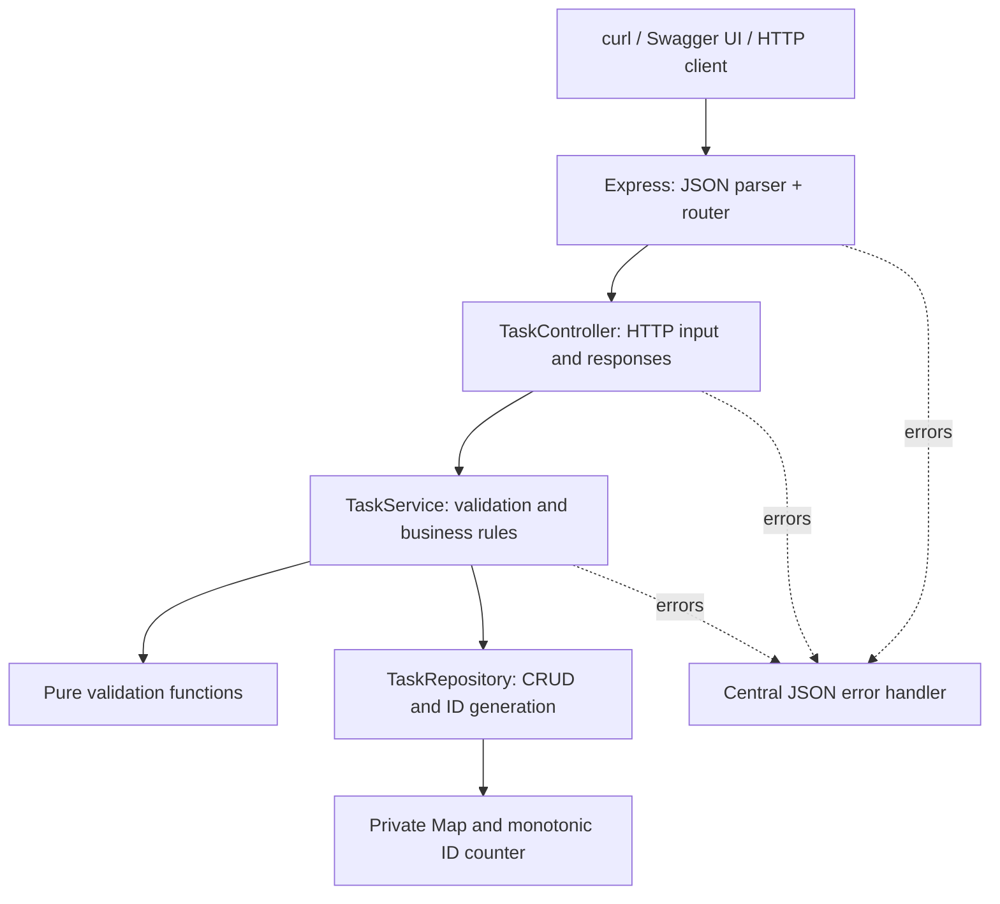
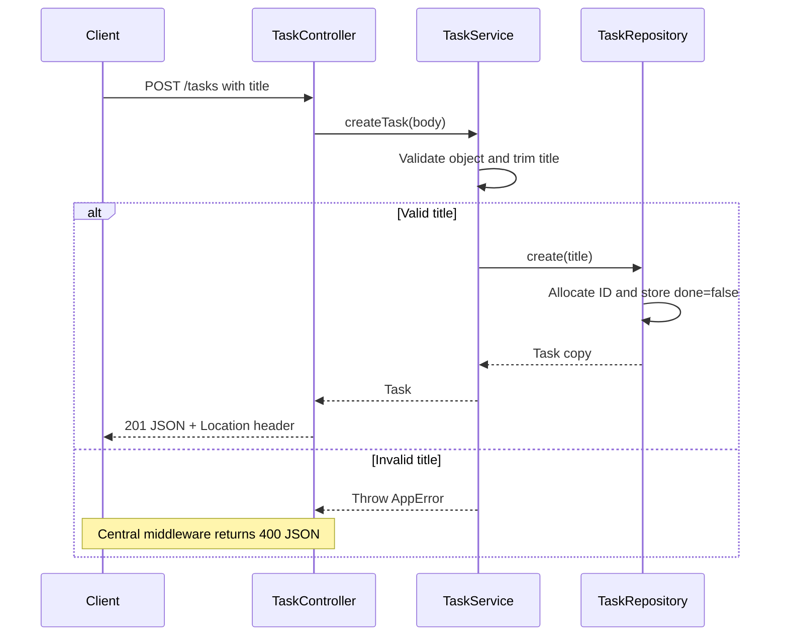
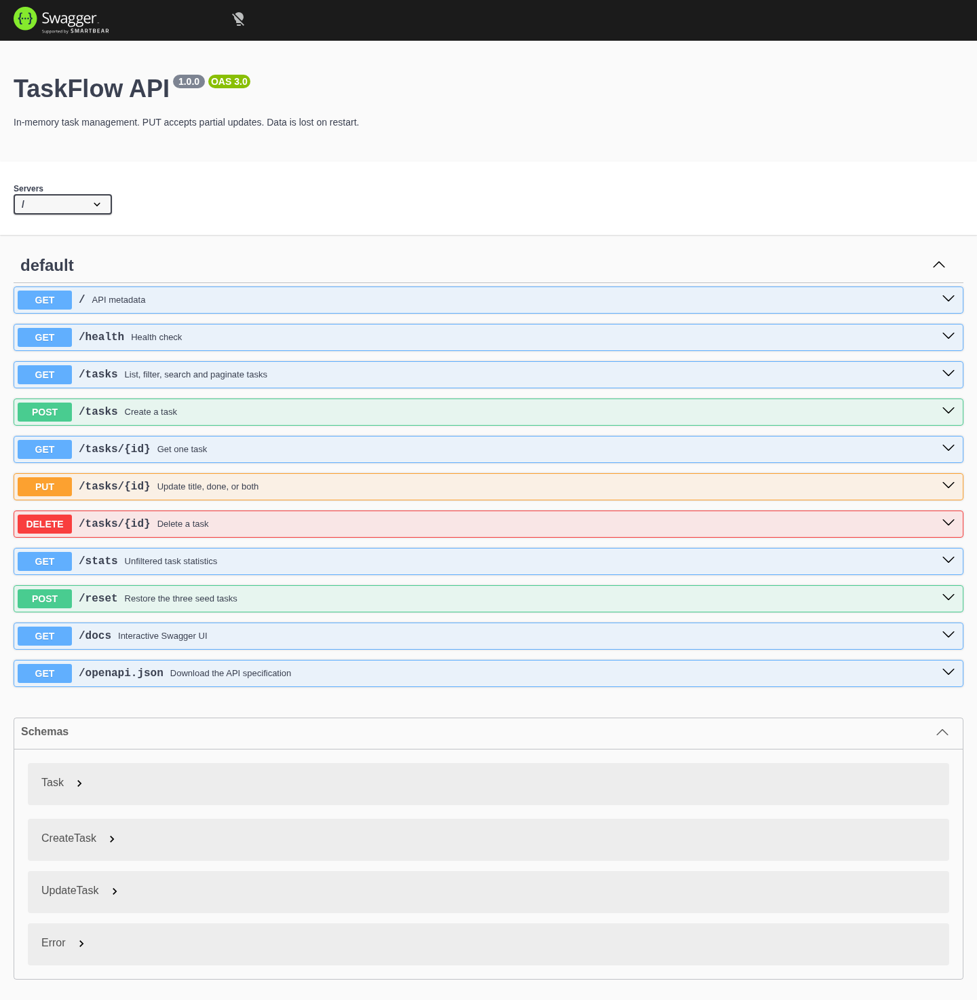

# TaskFlow API

A small REST API built around focused JavaScript classes, explicit validation, and in-memory storage. Created for **FlyRank Internship · Backend Development · Week 2 · Assignment A1**.

**Node.js · Express 5 · ES Modules · OpenAPI 3 · Native Node test runner**

## Quick start

Requires **Node.js 22 or newer (a supported LTS release recommended)**, npm, and optionally Git and curl.

From the project directory:

```bash
npm ci
npm start
```

- API: <http://localhost:3000>
- Interactive documentation: <http://localhost:3000/docs>
- OpenAPI JSON: <http://localhost:3000/openapi.json>
- Health check: <http://localhost:3000/health>

No environment file, database, credentials, build step, or external service is needed. `npm install` also works; `npm ci` uses the committed lockfile. Set a different port with `PORT=4000 npm start` on Linux/macOS. Stop with `Ctrl+C`.

## Commands

| Command                | Purpose                                                    |
| ---------------------- | ---------------------------------------------------------- |
| `npm start`            | Start the HTTP server                                      |
| `npm run dev`          | Restart automatically when source files change             |
| `npm test`             | Run isolated integration tests with Node's built-in runner |
| `npm run lint`         | Check JavaScript with ESLint                               |
| `npm run format`       | Format the project with Prettier                           |
| `npm run format:check` | Verify formatting without changing files                   |

## Architecture



- **Repository:** owns `#tasks` and `#nextId`; returns copies so callers cannot mutate storage accidentally.
- **Service:** validates inputs, handles missing tasks, and coordinates repository operations.
- **Controller:** translates HTTP input/output; never edits stored tasks directly.
- **Routes:** map paths to controller methods without business logic.
- **Bootstrap:** `createApp()` wires fresh dependencies; `server.js` alone starts the listener.
- **Errors:** `AppError` carries expected HTTP status codes. Unexpected exceptions are logged server-side and return a generic JSON 500 without a stack trace.

Constructor injection and composition keep the layers testable without base classes, factories, ORMs, or simulated interfaces. Express 5 forwards synchronous handler exceptions to the error middleware.

### Request lifecycle



### Project layout

```text
src/
├── app.js                     # Application factory and dependency wiring
├── server.js                  # Listener, PORT and shutdown handling
├── controllers/TaskController.js
├── services/TaskService.js
├── repositories/TaskRepository.js
├── routes/
│   ├── index.js               # Root metadata and health
│   ├── taskRoutes.js          # Required CRUD routes
│   └── utilityRoutes.js       # Optional statistics and reset
├── validators/taskValidator.js
├── errors/AppError.js
├── middleware/
│   ├── errorHandler.js
│   └── notFoundHandler.js
├── data/seedTasks.js
└── docs/openapi.json
tests/tasks.test.js
screenshots/swagger-ui.png
```

## Endpoint reference

| Method | Path            | Behavior                                       | Status codes       |
| ------ | --------------- | ---------------------------------------------- | ------------------ |
| GET    | `/`             | API name, version and links                    | 200                |
| GET    | `/health`       | `{ "status": "ok" }`                           | 200                |
| GET    | `/tasks`        | Task array; optional filters and pagination    | 200, 400           |
| GET    | `/tasks/:id`    | Retrieve one task                              | 200, 400, 404      |
| POST   | `/tasks`        | Create with a required title                   | 201, 400, 413      |
| PUT    | `/tasks/:id`    | Update title, done, or both                    | 200, 400, 404, 413 |
| DELETE | `/tasks/:id`    | Delete; empty response body                    | 204, 400, 404      |
| GET    | `/stats`        | Unfiltered total, completed and pending counts | 200                |
| POST   | `/reset`        | Restore original seed tasks                    | 200                |
| GET    | `/docs`         | Swagger UI; redirects to `/docs/`              | 301, then 200      |
| GET    | `/openapi.json` | OpenAPI document                               | 200                |

Unknown routes return JSON 404. Unexpected errors return JSON 500. Malformed JSON returns 400; parsed JSON bodies over 16kb return 413.

### Task contract

```json
{ "id": 1, "title": "Complete FlyRank assignment", "done": false }
```

- IDs are positive safe integers generated by the server. Path IDs reject leading zeros, decimals, signs, suffixes, and unsafe integers.
- Titles must be strings containing non-whitespace text. Surrounding whitespace is removed.
- POST always initializes `done` to `false`, even if the client supplies another value.
- PUT intentionally supports **partial updates**, as required by the assignment, although PATCH would normally describe that behavior. Omitted properties are preserved.
- PUT requires at least one recognized field; `done` must be a JSON Boolean. Unknown body fields are ignored and cannot override `id`.
- Invalid updates are rejected before any mutation. For valid IDs, invalid update bodies take precedence over a missing-task check.
- Send bodies with `Content-Type: application/json`.

All error responses use one shape:

```json
{ "error": "Task 99 not found" }
```

## Manual CRUD walkthrough

On a fresh process the three sample tasks have IDs 1–3. The first created task has ID 4. If you already created tasks, use the ID returned by POST instead.

```bash
# Read
curl -i http://localhost:3000/tasks
curl -i http://localhost:3000/tasks/1

# Create
curl -i -X POST http://localhost:3000/tasks \
  -H 'Content-Type: application/json' \
  -d '{"title":"Buy milk"}'

# Update
curl -i -X PUT http://localhost:3000/tasks/4 \
  -H 'Content-Type: application/json' \
  -d '{"title":"Buy groceries","done":true}'

# Delete, then confirm 404
curl -i -X DELETE http://localhost:3000/tasks/4
curl -i http://localhost:3000/tasks/4

# Validation error
curl -i -X POST http://localhost:3000/tasks \
  -H 'Content-Type: application/json' \
  -d '{"title":"   "}'
```

### Actual captured curl response

Captured from the running application with the POST command above, not an illustrative response:

```http
HTTP/1.1 201 Created
Location: /tasks/4
Content-Type: application/json; charset=utf-8
Content-Length: 40
ETag: W/"28-PpSBYV7i68cXyGc7AhjVpkZkY5Q"
Date: Sun, 25 Oct 2026 11:20:02 GMT
Connection: keep-alive
Keep-Alive: timeout=5

{"id":4,"title":"Buy milk","done":false}
```

Dates, generated IDs, and ETags vary with the request and process state.

## Swagger UI



The image is a real browser capture of `/docs/`. Mermaid diagrams render directly on GitHub; no frontend or Mermaid runtime dependency is needed in the API.

To evaluate without curl, expand each operation and select **Try it out**, enter its values, then select **Execute**:

1. POST `/tasks` with a title; record the returned ID.
2. GET `/tasks`; confirm the new task exists.
3. PUT `/tasks/{id}` with a new title and `done: true`.
4. GET `/tasks/{id}`; verify both fields.
5. DELETE `/tasks/{id}`; expect 204 with no body.
6. GET `/tasks/{id}` again; expect JSON 404.

This sequence was also verified through Swagger UI in headless Chromium using actual Try it out / Execute controls.

## Optional enhancements

### Filtering, search and pagination

```bash
curl -i 'http://localhost:3000/tasks?done=false'
curl -i 'http://localhost:3000/tasks?search=swagger'
curl -i 'http://localhost:3000/tasks?done=false&search=assignment&limit=2&offset=0'
```

| Parameter | Rules                                                        |
| --------- | ------------------------------------------------------------ |
| `done`    | Exact `true` or `false`                                      |
| `search`  | Trimmed, case-insensitive title substring; empty matches all |
| `limit`   | Positive safe integer; omitted means no limit                |
| `offset`  | Non-negative safe integer; defaults to 0                     |

Filtering and searching combine with AND and run **before pagination**. Results retain insertion order and the required JSON-array response. Offsets beyond the result set return `[]`. Unknown or repeated parameters return 400; numeric values cannot contain signs, decimals, or leading zeros.

### Statistics

```bash
curl -i http://localhost:3000/stats
```

Fresh-process response: `{ "total": 3, "completed": 1, "pending": 2 }`. Counts cover the entire current collection, not a filtered page.

### Reset

**`POST /reset` discards the current collection and restores the three original sample tasks.** It is an unauthenticated local-development helper, not a production administration endpoint.

```bash
curl -i -X POST http://localhost:3000/reset
```

Returns the restored task array. Reset preserves the next generated ID, so previously generated IDs are never recycled during the lifetime of the application. Original seed IDs are restored intentionally. Restarting the process resets all state, including the ID counter.

## Tests and quality checks

```bash
npm test
npm run lint
npm run format:check
```

The suite covers all **TC-01–TC-18** cases plus query composition, malformed IDs, invalid body shapes, atomic updates, immutable IDs, statistics, reset, application isolation, repository copies, malformed JSON, request size limits, unknown routes, and documentation availability.

Each HTTP test creates a fresh application and repository, listens on an OS-assigned local port, and closes its server afterward. No third-party HTTP testing framework is needed. Importing `createApp()` does not open a port. Browser tooling used to capture the screenshot is not a project or runtime dependency.

## Storage and security boundaries

- Storage is a JavaScript `Map` in one process. **Every restart loses all changes.** Nothing is persisted to disk or a database.
- Instances do not share data; there are no transactions across processes or durable guarantees.
- There is no authentication, authorization, rate limiting, or production deployment configuration. Any client that can reach the server can modify tasks and invoke reset. Use only in a trusted local evaluation environment; do not expose it publicly as-is.
- Validation, the small JSON body limit, generic unexpected-error responses, and disabled `X-Powered-By` header provide basic request hygiene, not a production security guarantee.

## Implementation stages and provenance

The local Git history records incremental Stages 0–6: server setup; root/health; read layers; create; update/delete; Swagger; documentation. Optional enhancements and automated tests follow in a separate commit. Inspect with:

```bash
git log --oneline --reverse
```

**This implementation was AI-assisted.** Stage-based commits document development increments; they do not establish compliance with FlyRank's requirement that Stages 0–6 be hand-built. Review the assignment's AI policy and implement the required work yourself where that policy requires it. No AI Rematch or comparison findings are claimed: there is no independent hand-built baseline to compare against, and duplicating this implementation would not provide an honest comparison.

### Publish to GitHub

Publishing is not automatic. Create an empty **public** repository in your GitHub account, then substitute its URL:

```bash
git branch -M main
git remote add origin https://github.com/YOUR_USERNAME/taskflow-api.git
git push -u origin main
```

The local stage commits use a clearly labeled builder identity. Configure your own Git author before making subsequent commits. Public publishing, your own work under the assignment's hand-built rules, and submission review remain your responsibility.
