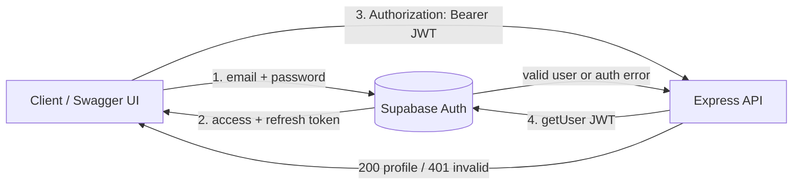
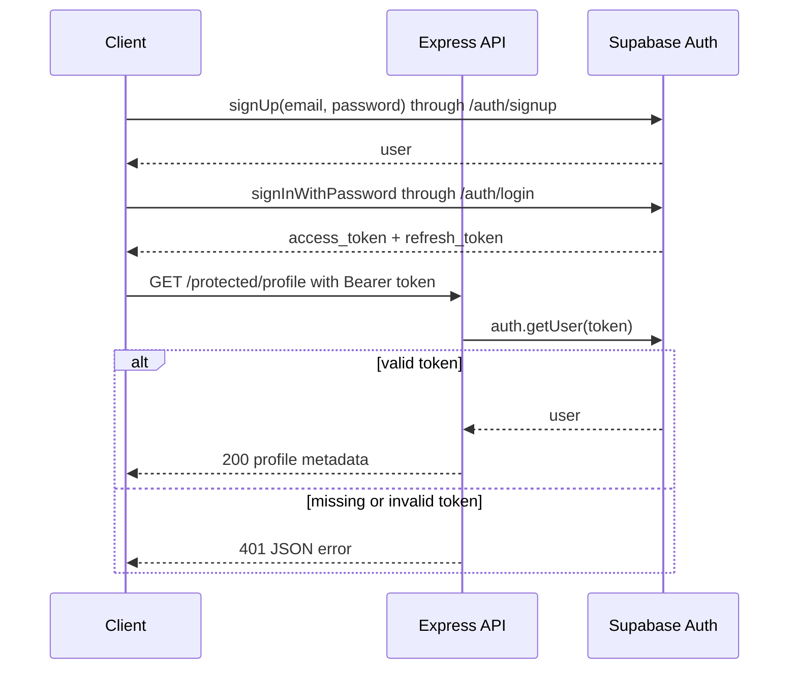
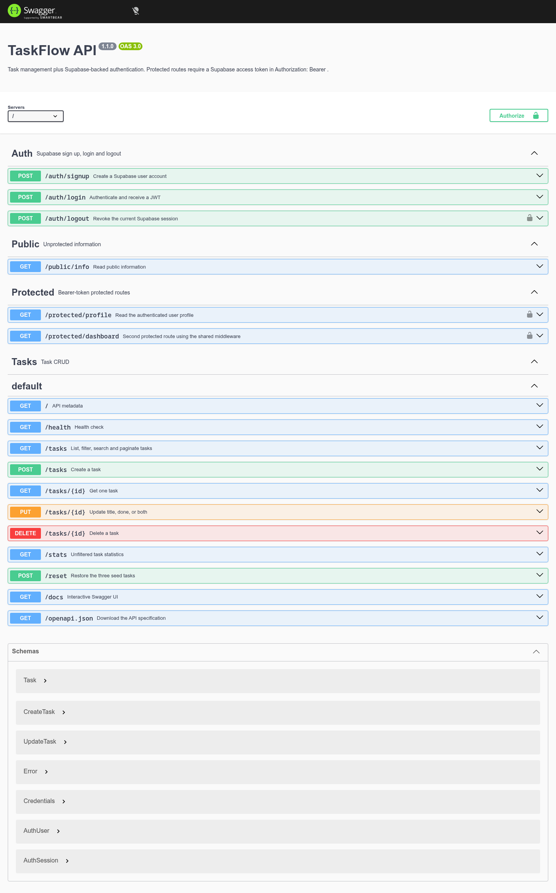
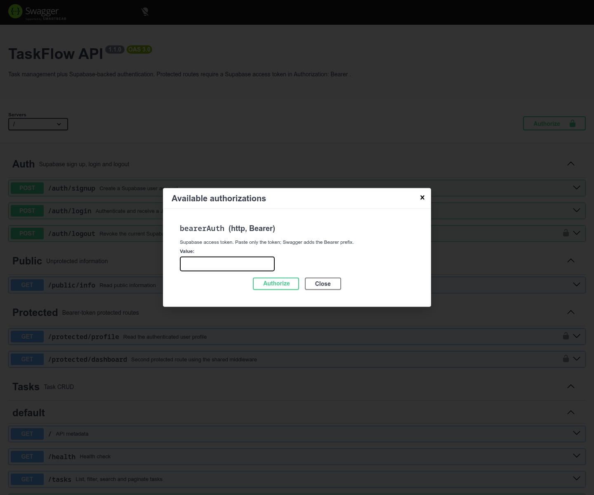

# TaskFlow API — Supabase Auth & Protected Routes

A small Express API that combines the existing task-management endpoints with **Supabase Auth**. Users can sign up, log in, receive a JWT, and use that token to access protected profile and dashboard routes. Passwords are handled by Supabase and never stored by this backend.

The project also retains the A3 Postgres/SQLite task storage from earlier work. Authentication is additive: task routes, validation, and the OpenAPI UI continue to work.

## Stack

- Node.js 22+ and JavaScript ES Modules
- Express 5
- `@supabase/supabase-js` for Supabase Auth
- `swagger-ui-express` and OpenAPI 3 at `/docs`
- Optional Postgres (`pg`) or local SQLite fallback for tasks
- Node's built-in test runner

## Quick start

### 1. Create a Supabase project

1. Create a free project at <https://supabase.com>.
2. Open **Project Settings → API**.
3. Copy the **Project URL** and the **anon/public key**.

Do not use the `service_role` key. This API only needs the anon key.

### 2. Configure environment variables

```bash
cp .env.example .env
```

Edit `.env`:

```dotenv
SUPABASE_URL=https://your-project-ref.supabase.co
SUPABASE_KEY=your-anon-public-key
PORT=3000
```

`.env` is gitignored. `.env.example` is committed and contains no real credentials.

### 3. Run

```bash
npm ci
npm start
```

Open:

- API: <http://localhost:3000>
- Swagger UI: <http://localhost:3000/docs>
- Public endpoint: <http://localhost:3000/public/info>
- Health: <http://localhost:3000/health>

Expected startup log:

```text
Task storage: SQLite fallback (set DATABASE_URL to use Postgres)
TaskFlow API listening on http://localhost:3000
Server running and connected to Supabase
```

`npm start` performs a lightweight Supabase health check before opening the HTTP port. Without `DATABASE_URL`, the task store falls back to local SQLite so the auth assignment can run without Docker. Set `DATABASE_URL` to use Postgres, or use the Compose stack below.

### Optional: full Postgres stack

```bash
docker compose up --build
```

Compose starts Postgres with a persistent volume and the app together. It builds `DATABASE_URL` from the `POSTGRES_*` values in `.env` and passes the Supabase variables to the app. See `sql/001-init.sql` and `scripts/verify-persistence.js` for the A3 database work.

## Authentication architecture





The backend does not decode or trust the JWT locally. Every protected request calls Supabase's `getUser(token)`, so expired, tampered, or revoked tokens are rejected by the identity provider.

### Request flow and status codes

| Route                      | Auth   | Success                                 | Errors                                                                        |
| -------------------------- | ------ | --------------------------------------- | ----------------------------------------------------------------------------- |
| `POST /auth/signup`        | None   | `201` user object                       | `400` missing/invalid input or provider validation; `429` provider rate limit |
| `POST /auth/login`         | None   | `200` access token, refresh token, user | `400` missing fields; `401` invalid credentials; `429` rate limit             |
| `POST /auth/logout`        | Bearer | `204` empty body                        | `401` missing/invalid token                                                   |
| `GET /public/info`         | None   | `200` public message                    | —                                                                             |
| `GET /protected/profile`   | Bearer | `200` user metadata                     | `401` missing/invalid/expired token                                           |
| `GET /protected/dashboard` | Bearer | `200` dashboard message + user          | `401` missing/invalid/expired token                                           |

Existing task endpoints remain available: `/tasks`, `/tasks/:id`, `/stats`, `/reset`, `/health`, and `/docs`.

All errors use:

```json
{ "error": "message" }
```

## API examples

Start with a real Supabase project, or use a test provider. The commands below are the exact contract.

### Sign up

```bash
curl -i -X POST http://localhost:3000/auth/signup \
  -H 'Content-Type: application/json' \
  -d '{"email":"test@example.com","password":"password123"}'
```

```http
HTTP/1.1 201 Created
Content-Type: application/json; charset=utf-8

{"user":{"id":"8f14e45f-ea2c-4b1a-9c3a-4f0f0f0f0f0f","email":"test@example.com","created_at":"2026-01-01T00:00:00.000Z","email_confirmed_at":null,"last_sign_in_at":"2026-01-02T00:00:00.000Z"}}
```

Supabase may require email confirmation before login, depending on project settings.

### Log in

```bash
curl -i -X POST http://localhost:3000/auth/login \
  -H 'Content-Type: application/json' \
  -d '{"email":"test@example.com","password":"password123"}'
```

```json
{
  "access_token": "<supabase-jwt>",
  "refresh_token": "<refresh-token>",
  "token_type": "bearer",
  "expires_in": 3600,
  "user": {
    "id": "8f14e45f-ea2c-4b1a-9c3a-4f0f0f0f0f0f",
    "email": "test@example.com",
    "created_at": "2026-01-01T00:00:00.000Z",
    "email_confirmed_at": null,
    "last_sign_in_at": "2026-01-02T00:00:00.000Z"
  }
}
```

Copy `access_token` for the protected requests.

### Public and protected access

```bash
curl -i http://localhost:3000/public/info
# 200 {"message":"Welcome stranger! This info is public."}

curl -i http://localhost:3000/protected/profile
# 401 {"error":"Access token required"}

curl -i http://localhost:3000/protected/profile \
  -H "Authorization: Bearer $ACCESS_TOKEN"
# 200 {"user":{...}}

curl -i http://localhost:3000/protected/dashboard \
  -H "Authorization: Bearer $ACCESS_TOKEN"
# 200 {"message":"Welcome to your protected dashboard","user":{...}}
```

Change one character in the token and the response becomes:

```http
HTTP/1.1 401 Unauthorized
Content-Type: application/json

{"error":"Invalid or expired token"}
```

### Logout

```bash
curl -i -X POST http://localhost:3000/auth/logout \
  -H "Authorization: Bearer $ACCESS_TOKEN"
# 204 No Content
```

The logout route is protected by the same middleware. It calls Supabase's logout endpoint with the verified bearer token and the anon key.

> **Implementation note:** the Supabase JavaScript SDK's `auth.signOut()` operates on a client-side stored session. This API is stateless and receives only an access token, so it calls Supabase's `/auth/v1/logout?scope=local` endpoint with that token. The result is the same session revocation; the SDK's client-session helper is not a fit for server-side bearer-only requests.

## Swagger UI



The lock icons mark `POST /auth/logout`, `GET /protected/profile`, and `GET /protected/dashboard`. To test from the browser:

1. Open <http://localhost:3000/docs>.
2. Click **Authorize**.
3. Paste only the `access_token` value from `/auth/login` into `bearerAuth`.
4. Click **Authorize**, then **Try it out** on `/protected/profile`.
5. Execute and confirm `200` with your user metadata.



The screenshot was captured against a local stub identity provider; it demonstrates the UI and bearer wiring, not a real Supabase project.

## Security decisions

- Passwords are sent to Supabase Auth and never hashed, logged, or stored by this backend.
- The JWT is verified server-side with `supabase.auth.getUser(token)` on every protected request.
- The middleware accepts only `Authorization: Bearer <token>`; missing, malformed, and multi-token headers return `401` before route logic runs.
- Protected route handlers receive `req.user` and `req.accessToken` only after verification.
- Invalid login attempts always return the generic `Invalid login credentials` message.
- `.env` is gitignored. Only the anon/public key is used; no `service_role` key is required or documented.
- Unexpected provider/network failures return a generic `500`; stack traces are not sent to clients.
- There is no CORS configuration, rate limiter, refresh-token rotation endpoint, or production deployment hardening in this assignment. Add those before exposing the API to a browser client or the public internet.

Check the secret is ignored:

```bash
git check-ignore .env
# .env
```

## Tests

```bash
npm test
npm run lint
npm run format:check
```

The auth suite covers:

- Signup/login validation and status codes.
- Provider validation failures and generic invalid credentials.
- Missing, malformed, tampered, and valid bearer tokens.
- Middleware protection on both protected routes.
- Logout `204` with an empty body.
- `SupabaseAuthService` mapping of SDK results and logout requests.
- The real `@supabase/supabase-js` client against a local fake Supabase HTTP server.
- Startup configuration failures.

`npm test` currently reports **40 passing tests and 1 skipped** test. The skipped test is the real Postgres integration test, which requires `TEST_DATABASE_URL` and a running database. Docker is not required for the auth tests.

### Verification status

- ✅ Auth lifecycle tested end-to-end with the real Supabase SDK against a local fake provider.
- ✅ Swagger **Authorize** + **Try it out** returned `200` for `/protected/profile` using a stub token.
- ⏳ Real Supabase project verification is pending; no project credentials were available in this environment.
- ⏳ Docker/Postgres persistence verification is pending because the Docker daemon was unavailable.
- The screenshots are UI evidence from the stub provider, not evidence of a live Supabase project.

Do not copy the stub token into a real environment; it is test data.

## Project structure

```text
src/
├── app.js                       # Express factory and dependency wiring
├── server.js                    # Supabase health check, storage, listener
├── config/
│   ├── supabase.js              # Supabase client factory
│   ├── postgres.js              # Postgres pool
│   └── database.js              # A2 SQLite fallback
├── controllers/
│   ├── AuthController.js
│   └── TaskController.js
├── services/
│   ├── SupabaseAuthService.js
│   └── TaskService.js
├── middleware/
│   ├── authenticate.js          # Reusable bearer-token guard
│   └── errorHandler.js
├── routes/
│   ├── authRoutes.js            # Auth, public, protected routers
│   ├── taskRoutes.js
│   └── utilityRoutes.js
├── validators/
│   ├── authValidator.js
│   └── taskValidator.js
└── docs/openapi.json
tests/auth.test.js
screenshots/auth-swagger-ui.png
screenshots/auth-swagger-authorize.png
```

The auth layer uses constructor injection like the existing task layers. `createApp({ authService })` mounts auth routes only when a service is provided; `server.js` always provides the Supabase-backed service.

## Storage note from A3

- `DATABASE_URL` set → Postgres repository.
- `DATABASE_URL` absent → SQLite fallback for local auth development.
- Docker Compose sets Postgres and persists it in the `taskdata` volume.
- The A3 persistence script remains at `scripts/verify-persistence.js`.

## Scope and next steps

Not implemented in this assignment:

- The optional AI Rematch comparison.
- Refresh-token endpoint or automatic refresh flow.
- Role-based authorization (admin vs. user); this assignment demonstrates authentication and protected access.
- Production CORS, rate limiting, CSRF protection, and deployment configuration.

A natural next step is to add a role claim check in the middleware and a real Supabase project test in CI with secrets stored outside the repository.
